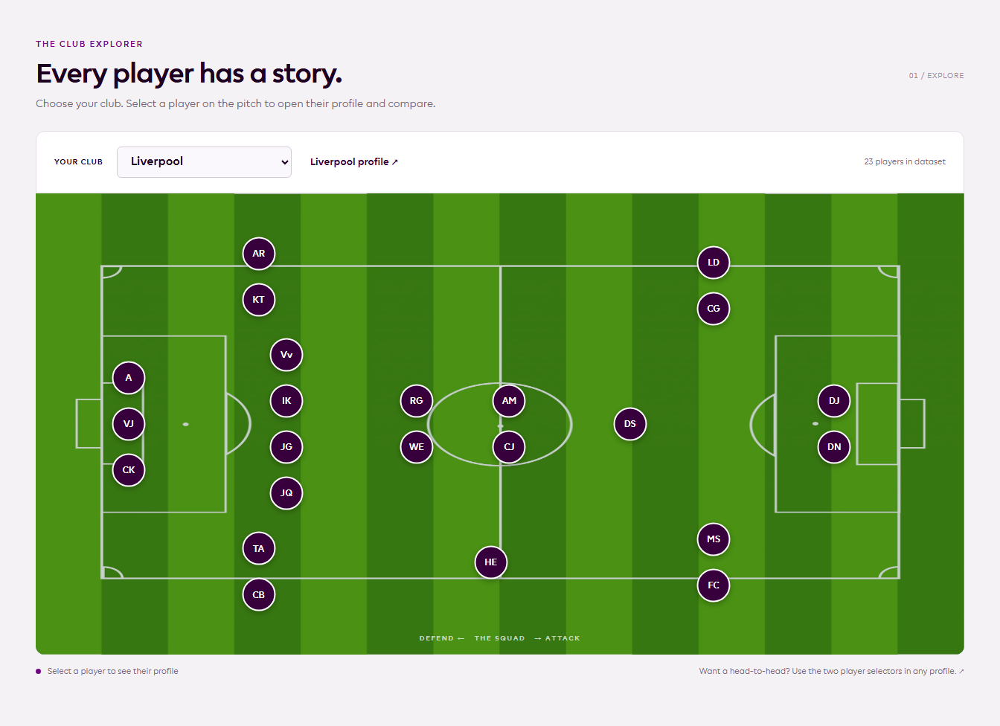
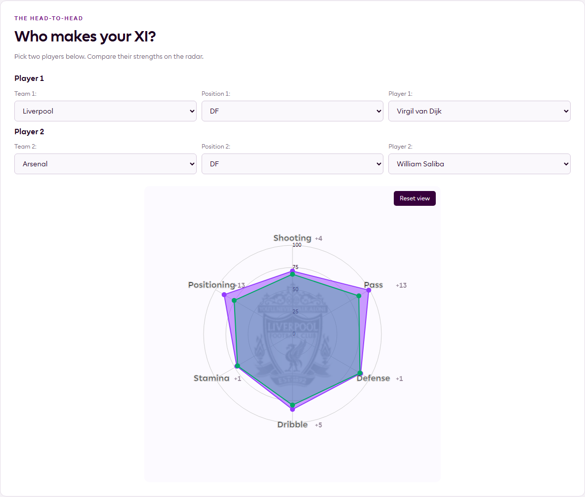
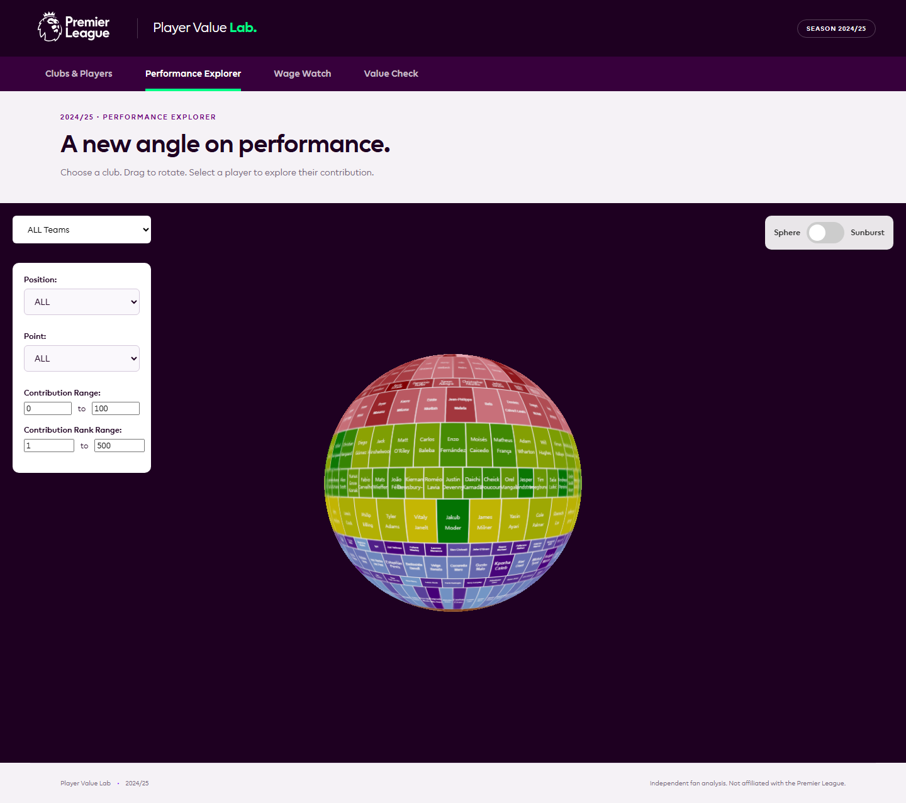
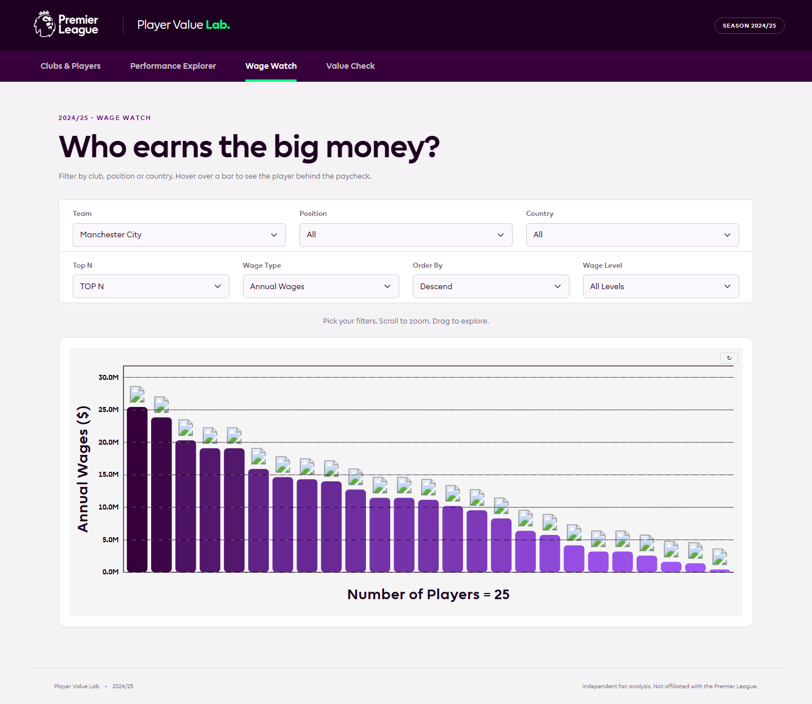
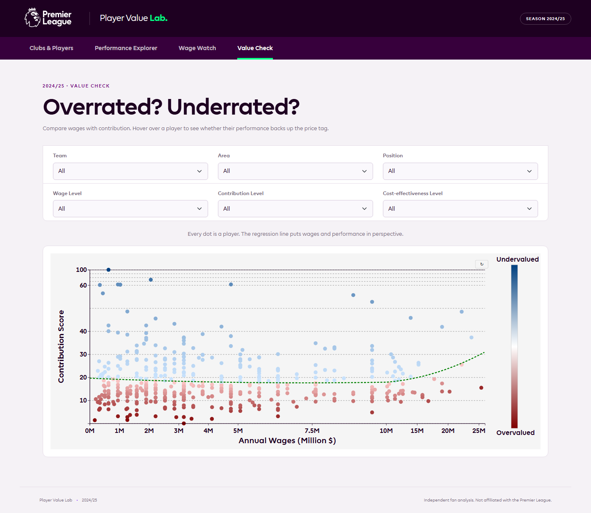

# 프리미어리그 선수 기여도·연봉 대비 가치 시각화

**선수의 경기력, 포지션, 연봉을 함께 살펴보고 두 선수의 강점과 상대적 가치를 비교하는 인터랙티브 분석 시스템입니다.**

[English](https://github.com/Heisenberg0607/premier-league-player-value-visualization/blob/main/premier-league-player-value-visualization/README.md) | [한국어](README.ko.md)

[배포 사이트](https://premier-league-player-value-visuali.vercel.app/dashboard/dashboard.html) · [현재 저장소](https://github.com/Heisenberg0607/premier-league-player-value-visualization) · [제출 보고서](https://github.com/Heisenberg0607/premier-league-player-value-visualization/blob/main/premier-league-player-value-visualization/docs/project_report.pdf)

| 항목 | 내용 |
| --- | --- |
| 프로젝트 성격 | 베이징대학교 《데이터 시각화》 수업의 4인 팀 프로젝트 |
| 분석 대상 | 프리미어리그 20개 구단, 약 500명의 선수 데이터 |
| 핵심 접근 | 포지션별 기여도 설계, 점수 표준화, 연봉 대비 기여도 분석, 시각적 비교 |
| 개인 역할 | 데이터 분석 로직·평가 프레임워크 설계 주도, 전처리·기여도·가성비 분석, 레이더 차트 선수 비교 기능 중점 구현 |
| 공개 형태 | D3.js·Three.js 기반 정적 웹 애플리케이션, Vercel 배포 |

## 프로젝트 개요

### 문제정의

원시 축구 통계만으로는 서로 다른 포지션의 역할과 선수별 연봉 차이를 함께 고려해 선수를 비교하기 어렵습니다. 이 프로젝트는 경기력 지표와 연봉을 연결하여, 사용자가 선수의 강점과 연봉 대비 기여도를 탐색할 수 있도록 만들었습니다.

### 해결방법

FBref에서 확보한 경기력·포지션·연봉 데이터를 정리하고, 포지션별로 다른 지표를 사용하는 기여도 평가 체계를 설계했습니다. 보고서상 기여도 산출 절차는 그룹별 Z-Score 표준화와 Min-Max 정규화를 거쳐 0–100점으로 표현하며, D3.js와 Three.js로 선수 비교 및 기여도 탐색 화면을 구성했습니다.

### 결과물 활용

사용자는 구단을 선택해 선수 프로필을 조회하고, 두 선수의 능력 지표를 레이더 차트로 비교할 수 있습니다. 연봉과 기여도의 관계를 산점도로 살펴보고, 팀·포지션·연봉 구간·분류 조건으로 관심 선수를 좁혀볼 수 있습니다.

## 주요 결과와 화면

프로젝트 전체 결과물은 **구단·선수 탐색, 두 선수 비교, 3D 기여도 탐색, 연봉 분석, 연봉 대비 가치 분류**를 연결한 웹 시스템입니다. 프로필·연봉 데이터는 501명, 기여도·가성비 데이터는 487명으로 구성됩니다.

아래 이미지는 실제 배포 사이트에서 캡처했습니다. 현재 공개본은 수업 팀 프로젝트를 바탕으로 UI와 공개 배포 구성을 정리한 버전이며, 제출 당시 화면은 프로젝트 보고서에 수록되어 있습니다.

| 첫 화면 | 구단·선수 탐색 |
| --- | --- |
|  |  |

| 두 선수 비교 | 3D 기여도 탐색 |
| --- | --- |
|  |  |

| 연봉 분석 | 연봉 대비 기여도 분석 |
| --- | --- |
|  |  |

## 개인 기여도

팀 프로젝트에서 **데이터 분석 로직과 선수 평가 프레임워크 설계를 주도**했습니다.

| 담당 영역 | 수행 내용 |
| --- | --- |
| 데이터 정제·통합 | 선수 경기력, 포지션, 연봉 데이터를 분석과 시각화에 사용할 수 있도록 정제·통합했습니다. |
| 포지션별 기여도 설계·계산 | 역할별 성과 지표를 선정하고, 그룹별 표준화·정규화를 포함한 기여도 산출 체계를 설계·계산했습니다. |
| 연봉 대비 가치 분석 | 연봉과 기여도를 연결해 가성비를 계산하고, 기준선 대비 고평가·저평가 선수 분류를 담당했습니다. |
| D3.js 선수 비교 | 시각화 개발에 참여했으며, 레이더 차트 기반 두 선수 비교 기능을 중점적으로 구현했습니다. |

## 데이터와 전처리

데이터 출처는 제출 보고서에 명시된 **FBref 경기력·선수 및 구단 연봉 자료**입니다. 현재 웹 애플리케이션은 가공된 JSON·CSV·JavaScript 데이터를 읽습니다.

| 데이터 파일 | 레코드 수 | 사용 범위 |
| --- | ---: | --- |
| `dashboard/players_data.json` | 459 | 필드 플레이어 프로필·비교 |
| `dashboard/GK_Data.json` | 42 | 골키퍼 프로필·비교 |
| `salary/wage_player_data.js` | 501 | 연봉 막대그래프 |
| `sphere_graph/con_merge_rank_s.csv` | 487 | 3D·Sunburst·구단 정보 |
| `salary/scatterplot_data.js` | 487 | 연봉 대비 기여도 산점도·선수 분류 |

각 파일은 사용 목적과 포함 대상이 다르므로, 하나의 동일한 분석 표본으로 합산하지 않습니다. 위 숫자는 공개 파일의 레코드를 직접 집계한 값입니다.

**제출 보고서에 기술된 전처리**는 표 수동 확보 후 pandas를 이용한 형식·결측값 정리, 출전 기록이 없는 선수 제외, 이적 선수의 중복 기록 통합입니다. 저장소의 `sphere_graph/data.ipynb`에서는 Excel→CSV 변환과 좌표 열 병합 코드를 확인할 수 있으며, 전체 전처리·점수 계산 절차의 재현 범위는 아래 한계에 정리했습니다.

현재 사이트의 시즌 표기는 **2024/25**입니다. 제출 보고서의 시즌 표기 차이는 한계 및 개선 방향에 명시했습니다.

## 분석 방법과 시스템 구조

### 1. 포지션에 따라 다른 기여도 지표 구성

골키퍼, 중앙 수비수, 측면 수비수, 수비형 미드필더, 중앙·공격형 미드필더, 공격수의 **6개 평가 그룹**을 사용합니다. 역할별로 성과를 해석할 수 있도록 지표 구성을 달리했습니다.

| 평가 그룹 | 지표 예시 |
| --- | --- |
| 골키퍼 | 선방률, 클린시트 기여, PSxG-GA |
| 중앙 수비수 | 공중볼 경합 성공률, 차단·걷어내기·가로채기 기여 |
| 측면 수비수 | 크로스, 전진 운반, 태클 기여 |
| 수비형 미드필더 | 볼 회수, 가로채기, 전진 패스 |
| 중앙·공격형 미드필더 | 키 패스, 슈팅 기회 창출, 기대 도움 |
| 공격수 | 득점, 도움, 기대 득점, 전진 패스 수신 |

보고서에서 설명하는 기여도 계산은 역할별 지표와 출전 시간 비중을 반영합니다. 서로 다른 값의 범위를 정리하기 위해 **평가 그룹별 기여도를 Z-Score로 표준화한 뒤 Min-Max 정규화하여 0–100점으로 표시**합니다.

### 2. 연봉과 기여도를 연결해 상대적 가치 탐색

산점도의 가로축은 **연봉(백만 미국 달러)**, 세로축은 **기여도 점수(0–100점)**입니다. 프런트엔드는 아래의 사전 계산된 2차 기준 곡선을 표시합니다.

```text
기준 기여도 = 0.0382 × x² − 0.5563 × x + 19.6367
x = 연봉(백만 미국 달러)
```

선수가 기준 곡선 위에 있는지 아래에 있는지와, 데이터에 저장된 거리의 Z-Score를 이용해 상대적인 저평가·고평가 상태를 표현합니다. 분류는 `Severely undervalued`, `Undervalued`, `Overvalued`, `Severely overvalued`의 네 범주이며, 심한 저평가·고평가는 각각 Z-Score가 +1 초과, −1 미만인 구간입니다.

여기서의 가치는 **연봉 대비 기여도**를 뜻하며, 이적료나 미래 성적을 추정하는 값과는 구분됩니다.

### 3. 비교 목적에 맞춘 시각화

| 기술·구조 | 역할과 선택 목적 |
| --- | --- |
| Python·pandas | 표 형식 데이터를 정리하고 시각화용 파일로 변환 |
| D3.js | 레이더 차트의 다차원 비교, 연봉 막대그래프, 산점도 및 필터·툴팁·확대/축소 구현 |
| Three.js | 기여도 분포를 3D 구체로 탐색하고 회전·확대/축소 제공 |
| HTML·CSS·JavaScript | 페이지 연결과 브라우저 상호작용 구성 |
| 정적 JSON·CSV·JavaScript 데이터 | 가공 결과를 브라우저에서 읽어 분석 화면에 표시 |

레이더 차트는 **골키퍼와 필드 플레이어의 지표를 구분**합니다. 레이더의 능력 축은 코드에서 별도로 산출·스케일링하는 값이며, 산점도의 종합 기여도 점수와 구분하여 해석합니다.

```text
경기력·포지션·연봉 자료
  → 정제·통합 및 포지션별 기여도 계산
  → 시각화용 JSON / CSV / JavaScript 파일
  → 브라우저에서 필터링·비교
     ├─ 구단 및 선수 프로필
     ├─ 레이더 차트 비교
     ├─ 3D 구체 / 2D Sunburst
     ├─ 연봉 막대그래프
     └─ 연봉 대비 기여도 산점도
```

## 평가 방법과 확인 결과

### 분석 결과 확인

현재 공개된 **가성비 데이터 487명**의 기여도 점수 범위는 **0–100점**입니다. 저장된 분류 결과는 다음과 같습니다.

| 분류 | 선수 수 |
| --- | ---: |
| 심한 저평가 | 58명 |
| 저평가 | 129명 |
| 고평가 | 260명 |
| 심한 고평가 | 40명 |
| 합계 | 487명 |

이 표는 해당 데이터와 기준 곡선에서 얻은 **탐색적 분류 분포**입니다. 활용 범위는 현재 표본 내 상대적 가치의 탐색이며, 실제 선수 가치와의 일치도는 별도 검증 과제입니다.

## 설치 및 실행

Python 3와 WebGL을 지원하는 최신 브라우저를 사용합니다. 저장소를 내려받은 뒤 다음과 같이 실행합니다.

```bash
git clone https://github.com/Heisenberg0607/premier-league-player-value-visualization.git
cd premier-league-player-value-visualization/premier-league-player-value-visualization
python -m http.server 8000
```

브라우저에서 [http://localhost:8000/](http://localhost:8000/)에 접속하면 첫 화면으로 이동합니다. D3의 JSON·CSV 로딩을 위해 HTTP 서버를 사용하며, 사진·구단 엠블럼·일부 CDN 리소스에는 인터넷 연결이 필요합니다.

저장소에 포함된 정적 파일 검사는 애플리케이션 폴더에서 실행할 수 있습니다.

```bash
python scripts/check_project.py
```

## 주요 디렉터리

아래는 저장소 내부의 `premier-league-player-value-visualization/` 폴더 기준입니다.

```text
premier-league-player-value-visualization/
├─ index.html                 # 대시보드 진입점
├─ dashboard/                 # 구단·선수 프로필, 레이더 차트
├─ salary/                    # 연봉 막대그래프, 가성비 산점도
├─ sphere_graph/              # 3D 구체, Sunburst, CSV, 부분 변환 노트북
├─ data_sources/              # 보관된 Excel 자료
├─ assets/                    # 현재 공개본의 공통 UI 리소스
├─ docs/                      # 제출 보고서와 방법론·기여도·배포 문서
├─ scripts/check_project.py   # 정적 파일 정합성 검사
└─ vercel.json                # 정적 사이트 URL 설정
```

## 원본·참고 자료·이용 조건

- **프로젝트 보고서:** [《数据可视化小组作业报告》](https://github.com/Heisenberg0607/premier-league-player-value-visualization/blob/main/premier-league-player-value-visualization/docs/project_report.pdf)
- **데이터 출처:** [FBref](https://fbref.com/), 제출 보고서의 데이터 설명 및 참고문헌
- **관련 구현:** `dashboard/radar_graph.js`, `salary/render_scatterplot.js`, `salary/scatterplot_data.js`

통계 데이터, 선수 사진, 구단·리그 상표, 폰트와 외부 라이브러리는 각 권리자 및 제공자의 이용 조건을 따릅니다. 공개 데모는 독립적인 수업·포트폴리오 프로젝트입니다.
