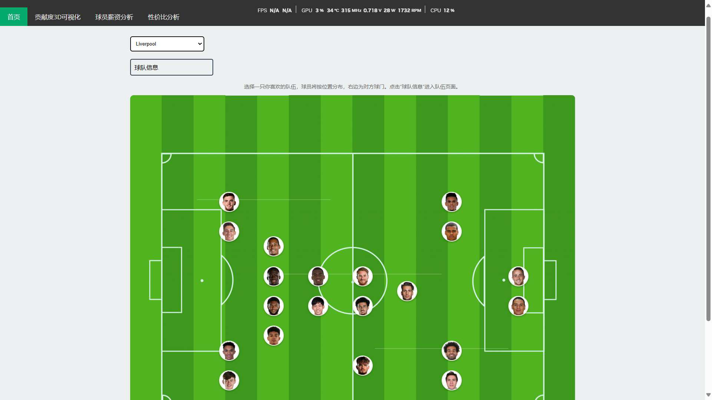
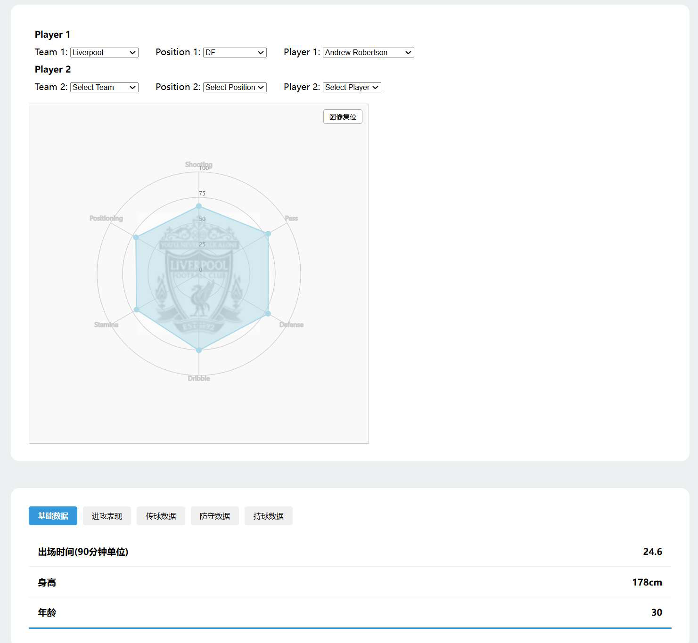
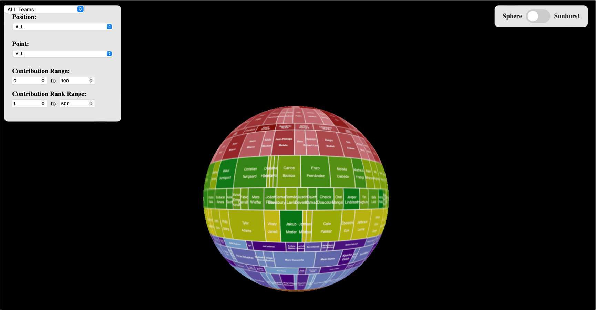
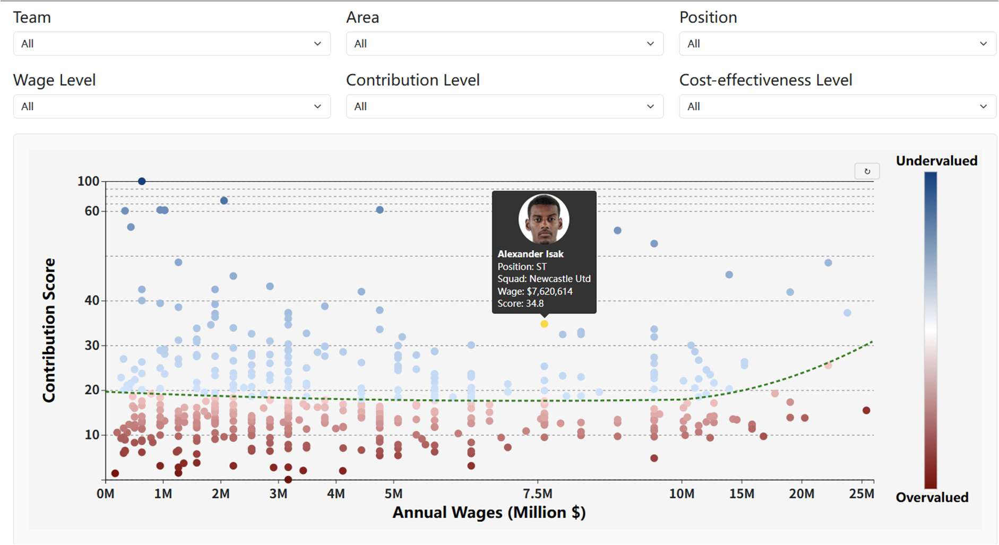

# Premier League Player Value Analytics ⚽

**An interactive football analytics dashboard combining on-field performance, position-aware contribution scoring, and wages.**

A **Peking University Data Visualization course group project** examining the value-for-money of English Premier League players. The report and data are presented as the **2024–25 season**; see [data notes](docs/METHODOLOGY.md#data-provenance-and-limitations) for an inconsistency in the report's season description.

**[Original team demo](https://jake-choi9233.github.io/Premier-League-Visualization/)** · **[Original team repository](https://github.com/Jake-Choi9233/Premier-League-Visualization)** · **[Project report (Chinese)](docs/project_report.pdf)** · **[한국어 가이드](README.ko.md)**

> **Portfolio notice:** This is a cleaned-up, deployment-ready presentation of a **four-person group project**, not an individually authored application. I have confirmed personal responsibility for **data preprocessing, radar-chart-based player analysis and comparison, salary analysis, and contribution-score formula design and calculation**. Other parts of the group application are not claimed as his individual work. The original group repository is credited above.

## Screenshots

| Interactive pitch | Player comparison |
|---|---|
|  |  |

| Contribution exploration | Performance vs wage |
|---|---|
|  |  |

_These are figures extracted from the project's submitted report, not screenshots of a newly verified deployment._

## What you can explore

| Page | Question it helps answer | Interactions |
|---|---|---|
| **Team dashboard** | Who is in the squad and where do they play? | Select club, click player, open club details |
| **Player profile and radar** | Where is one player stronger than another? | Position-aware comparison, tooltips, zoom |
| **3D Sphere / 2D Sunburst** | How is contribution distributed across positions/players? | Club/role filters, rotation, zoom, mode switch |
| **Wage distribution** | How are player salaries distributed? | Filter by team, position, country, wage level; sorting and zoom |
| **Cost-effectiveness scatterplot** | Who performs above/below the fitted wage–contribution baseline? | Multiple filters, hover, zoom, outlier exploration |

**Analytics approach:** 10 detailed on-field positions grouped into six position-specific scoring categories. Indicators are aggregated and normalized to a 0–100 contribution score within role groups; an **illustrative quadratic fitted baseline** relates the score to annual wages. Players above or below the fitted curve are visualized as relatively undervalued or overvalued. The scoring procedure is team-designed, **not** a validated industry scouting metric. Read the [methodology](docs/METHODOLOGY.md) before interpreting scores.

## My contributions

In this four-person course project, my **self-reported individual responsibilities** were:

| Area | What I worked on |
|---|---|
| **Data preprocessing** | Prepared and cleaned football performance and wage data for the project’s analysis and visualizations. |
| **Radar-based player comparison** | Analyzed player attributes and compared players using the position-aware radar-chart module. This describes my analytical work; it does not claim sole implementation of the module's code. |
| **Salary analysis** | Analyzed player wage distributions and their relationship to on-field performance/contribution to support the project's player-value perspective. |
| **Contribution-score design and calculation** | Designed the position-specific player-contribution formula and calculated contribution measures using performance indicators and playing-time considerations. The methodology and normalization are described in the [project report](docs/project_report.pdf) and [methodology notes](docs/METHODOLOGY.md). |

**Scope:** The team developed the overall interactive system together. This individual statement does **not** claim exclusive authorship of the 3D sphere, sunburst, website infrastructure, or all visualization code. See [detailed attribution and résumé bullets](docs/CONTRIBUTIONS.md).

## Technologies

- **D3.js v7:** radar, wage, scatterplot and 2D sunburst visualization
- **Three.js:** 3D contribution sphere with camera controls
- **HTML / CSS / vanilla JavaScript:** interactive frontend
- **Python / pandas:** offline preprocessing described in the report (full pipeline not included)
- **Static CSV / JSON / precomputed JavaScript datasets:** runtime data; no backend or credentials

## Quick start

Python 3 is sufficient to serve the static site (no npm installation required):

```bash
python -m http.server 8000
```

Then open **http://localhost:8000/**. Do not use `file://` or open HTML by double-clicking: `fetch()` and D3 CSV/JSON loading require a local HTTP server.

**Direct pages:**

- `/dashboard/dashboard.html` — interactive football pitch
- `/dashboard/player.html?name=Virgil%20van%20Dijk` — example outfield player
- `/dashboard/team.html?team=Liverpool` — team details
- `/sphere_graph/sphere.html` — 3D sphere / 2D sunburst
- `/salary/salary.html` — annual/weekly wage analysis
- `/salary/salary_ratio.html` — contribution vs annual wage

## Deployment

**GitHub Pages is recommended. Vercel is optional, not required.** This repository contains no server-side runtime.

**GitHub Pages:** create a repository, push this folder's **contents** (not the parent folder), then in **Settings → Pages → Build and deployment** select **Deploy from a branch → main → /(root)**. The root `index.html` redirects to the dashboard using a **relative path**, which works under `username.github.io/repo-name/`. A `.nojekyll` file is included.

**Vercel (optional):** import the GitHub repository, choose framework **Other**, leave Build Command blank, and use the repository root as the output directory. Keep all static folders together; no API keys or environment variables are needed.

See [DEPLOYMENT.md](docs/DEPLOYMENT.md) for step-by-step guidance and troubleshooting.

## Project structure

```text
.
├── index.html                    # GitHub Pages / Vercel entry point
├── dashboard/                   # Pitch, player pages and radar chart
│   ├── dashboard.html
│   ├── player.html
│   ├── team.html
│   ├── players_data.json
│   └── GK_Data.json
├── sphere_graph/                # 3D contribution sphere and sunburst
│   ├── sphere.html
│   ├── con_merge_rank_s.csv
│   └── data.ipynb               # Partial conversion notebook only
├── salary/                      # Salary chart and value scatterplot
│   ├── salary.html
│   ├── salary_ratio.html
│   ├── wage_player_data.js
│   └── scatterplot_data.js
├── data_sources/                # Additional Excel exports, not required for runtime
├── docs/
│   ├── project_report.pdf
│   ├── screenshots/
│   ├── METHODOLOGY.md
│   ├── CONTRIBUTIONS.md
│   └── DEPLOYMENT.md
├── scripts/check_project.py     # Repeatable static integrity checks
├── README.ko.md
├── .gitignore
├── .nojekyll
└── vercel.json
```

## Data and interpretability cautions

- Figures use **archived historical data**, not live scouting feeds. Player headshots and club crests are linked to external hosts and may occasionally fail to load.
- Performance scores compare **different position-specific indicator sets**; the score should not be treated as a universal causal measure of individual player value.
- **Low-minute outliers** are an acknowledged problem (the report discusses a five-minute appearance leading to an extreme contribution score).
- Salary and contribution data are not refreshed automatically; the original preprocessing scripts and raw FBref exports are **not fully present**, so end-to-end recomputation cannot currently be reproduced from this repository alone.
- The original report alternates between **2024–25** and **2020–21** in its season description. A final source reconciliation would be required before claiming fully audited data provenance.

## Team & attribution

**Self-reported contributions:** data preprocessing; player analysis/comparison through radar charts; salary analysis; contribution-score formula design and calculation. These contributions have been supplied by the team member and are not independently established by the group report or Git history. Other features remain attributed to the group as a whole. See [CONTRIBUTIONS.md](docs/CONTRIBUTIONS.md) for details.

**Data:** [FBref](https://fbref.com/) (historical performance / wage references, as cited in the report). **Original implementation:** the group members above. **Portfolio packaging:** documentation, static entrypoint, data integrity checks, bundled local D3 references, and narrowly scoped GK/team-page compatibility fixes. This repository makes no claim of ownership over third-party libraries, statistics, photographs, or club marks. No general redistribution license is asserted for third-party material.